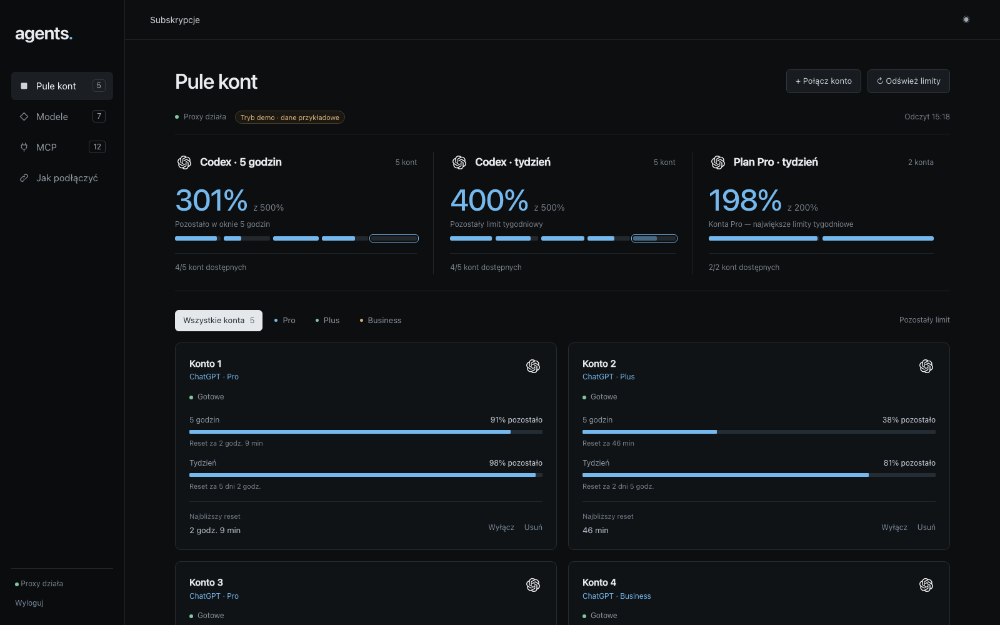
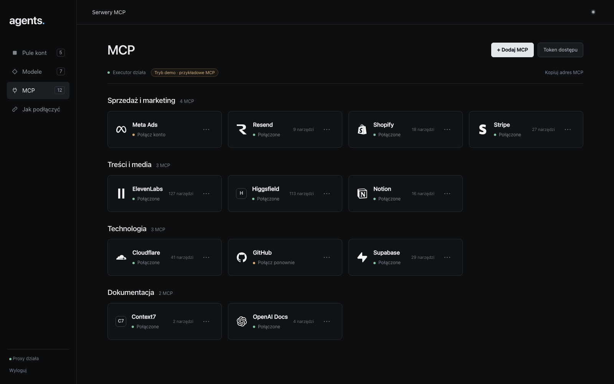

# Bramka AI — starter

Twoja własna bramka AI: kilka subskrypcji ChatGPT (Codex) pod **jednym adresem**, z panelem,
który pokazuje, ile limitu zostało na każdym koncie, oraz **wspólne serwery MCP**
(Stripe, Shopify, Meta Ads, Notion…) podłączone raz dla całego zespołu.

> [!IMPORTANT]
> **Z modeli Claude korzystamy wyłącznie w oficjalnych aplikacjach Claude (Claude, Claude Code)
> zalogowanych na własne konto — bramka służy do modeli innych dostawców.**
>
> Nie podłączamy też kont Google (Gemini/Antigravity) — regulaminy
> [Anthropic](https://code.claude.com/docs/en/legal-and-compliance) i
> [Google](https://piunikaweb.com/2026/02/23/google-antigravity-openclaw-ban/) zabraniają używania
> ich logowania w narzędziach zewnętrznych. Każde konto w bramce musi być Twoje i używane zgodnie
> z regulaminem dostawcy. Bramka obsługuje wyłącznie konta ChatGPT/Codex.



## Co dostajesz

- **Pule kont.** Łączysz swoje konta ChatGPT (Plus, Pro, Business) logowaniem w przeglądarce, bez haseł
  w plikach. Bramka rozkłada pracę między konta, a gdy jedno wyczerpie limit, przechodzi na następne.
- **Limity na żywo.** Panel pokazuje okna 5 godzin i tydzień dla każdego konta oraz pule: cała pula
  na 5 godzin, cała pula na tydzień i osobno tydzień kont Pro (największe limity).
- **Modele.** Lista modeli dostępnych przez bramkę i to, na ilu kontach każdy działa.
- **Wspólne MCP.** Serwery MCP dodajesz raz w panelu (także przez „Połącz konto”, OAuth); każdy w zespole
  dostaje jeden adres i własny token.
- **Przełączanie aplikacji.** Jeden skrypt przełącza Codex (CLI i aplikację) na bramkę i z powrotem.
  Opcjonalnie: modele innych dostawców w interfejsie Claude Code / Claude Desktop — z łatwym powrotem
  do normalnego logowania, w którym działa Claude.
- **Tryb demo.** Zanim podłączysz pierwsze konto, panel pokazuje dane przykładowe — od razu widać,
  jak to będzie wyglądać.



## Najprościej: niech zrobi to agent

Otwórz Claude Code albo Codex i wklej prompt z [PROMPT.md](PROMPT.md). Agent pokaże plan, poczeka
na Twoje „tak”, postawi bramkę na tym komputerze, sprawdzi, że działa, i powie, jak to cofnąć.

## Samodzielnie (10 minut)

Potrzebujesz Dockera (Docker Desktop, OrbStack albo colima) i terminala.

```bash
# w katalogu tego repozytorium
./przygotuj.sh                 # tworzy .env z losowymi hasłami
docker compose up -d --build   # bramka + MCP + panel
grep ^PANEL_HASLO .env         # hasło do panelu
```

1. Otwórz **http://localhost:8080**, zaloguj się hasłem z `.env`. Zobaczysz dane przykładowe.
2. **Pule kont → „+ Połącz konto”** → zaloguj się na chatgpt.com swoim kontem, skopiuj adres z paska
   (strona `localhost` z błędem to normalne) i wklej go w panelu.
   Po pierwszym koncie panel pokazuje już prawdziwe dane.
3. **MCP → „+ Dodaj MCP”** → adres serwera (np. `https://mcp.stripe.com`), potem „Połącz konto”.
4. Przełącz aplikacje: `./klienci/przelacz.sh` (najpierw pokazuje plan; szczegóły w [klienci/README.md](klienci/README.md)).

Cofnięcie wszystkiego: `./klienci/przelacz.sh --cofnij`, potem `docker compose down`
(dane zostają w wolumenach; `docker compose down -v` usuwa także konta i połączenia MCP).

Każdy dostawca ma własne warunki korzystania z subskrypcji — przed podłączeniem konta sprawdź,
czy Twój plan na to pozwala.

## Wersja lekka (jeden komputer): konta/

Pracujesz sam na jednym komputerze i masz kilka własnych kont Claude Code albo Codexa? Zamiast bramki
wystarczy [konta/](konta/README.md): przełącza konto jedną komendą, a historia sesji
(`claude --resume`, `codex resume`) zostaje wspólna. Każde konto loguje się oficjalnym przepływem
dostawcy; narzędzie nie dotyka danych logowania. Bez Dockera — gotowy prompt: [konta/PROMPT.md](konta/PROMPT.md).

---

## Część techniczna

```
 Codex / Claude Code (tryb gateway) / inne klienty ──► bramka :8317  (CLIProxyAPI, konta ChatGPT)
                                                         ▲ management API
 przeglądarka ──► panel :8080 ───────────────────────────┤
                                                         ▼ API Executora
 klienci MCP ──► Executor :4788/mcp (token per osoba) ──► serwery MCP (Stripe, Notion, …)
```

| Usługa | Obraz | Dane |
|---|---|---|
| `bramka` | `eceasy/cli-proxy-api:v7.3.15` (oficjalny, przypięty skrótem) | wolumen `bramka-dane` (pliki kont OAuth) |
| `executor` | `ghcr.io/usefulsoftwareco/executor-selfhost:1.6.10` (oficjalny, przypięty skrótem) | wolumen `executor-dane` (SQLite, tokeny MCP szyfrowane `EXECUTOR_SECRET_KEY`) |
| `panel` | budowany z `panel/` (Node 22, zero zależności) | brak (stan w pamięci) |

- Konfiguracja bramki: `konfiguracja/bramka/config.yaml` (round-robin + przypięcie rozmowy do konta na 1 h,
  ponowienia tylko przed pierwszym bajtem odpowiedzi, wyłączone kanały logowania innych dostawców). Tokeny dostępu
  (`TOKENY_DOSTEPU`) dopisuje `start.sh` przy starcie kontenera.
- Wszystko słucha tylko na `127.0.0.1`. Serwer z domeną i HTTPS: [docs/vps.md](docs/vps.md) (Caddy).
- Panel nie wywołuje modeli, nie zwraca tokenów i nie zapisuje treści rozmów. Limity czyta przez
  management API bramki (`api-call` z podmianą `$TOKEN$` — token konta nie opuszcza bramki).
- Tryb demo: `DEMO=auto` (domyślnie; demo, dopóki nie ma kont / MCP), `DEMO=1` zawsze, `DEMO=0` nigdy.
- Pule: „Codex · 5 godzin” i „Codex · tydzień” sumują pozostały limit wszystkich włączonych kont;
  „Plan Pro · tydzień” pojawia się, gdy w bramce są konta Pro i konta innych planów (plan z odczytu limitów).
- Testy panelu: `cd panel && npm test`; wersji lekkiej: `bash konta/testy/test_konta.sh`.
  Diagnostyka klientów: `./klienci/przelacz.sh --diagnostyka`.
- Instrukcja dla agentów stawiających bramkę: [AGENTS.md](AGENTS.md). Logotypy i ich licencje:
  [docs/logotypy.md](docs/logotypy.md).

Licencja: [MIT](LICENSE).
